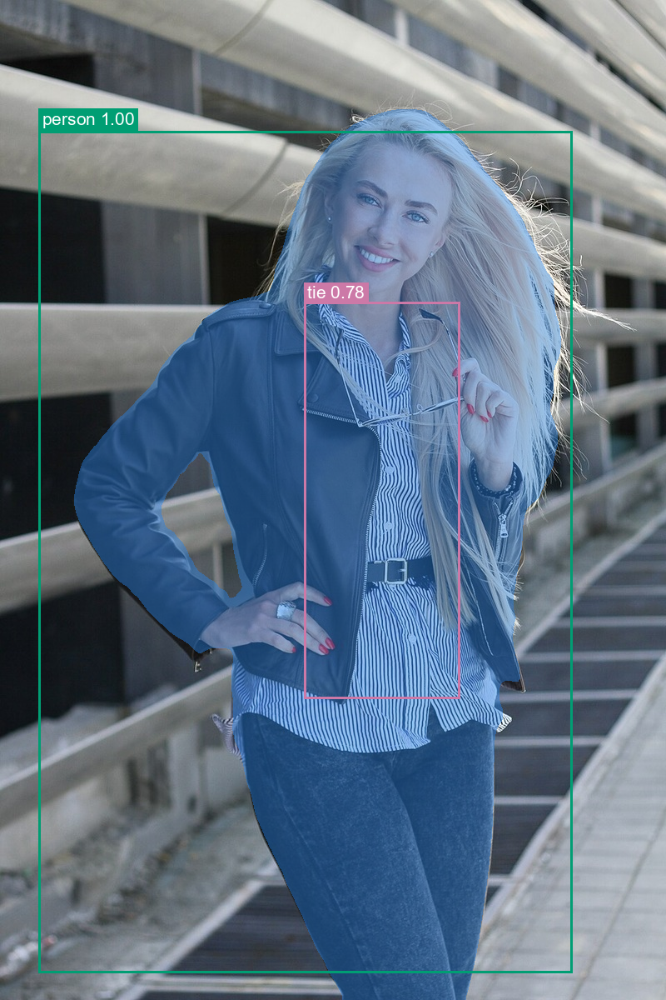
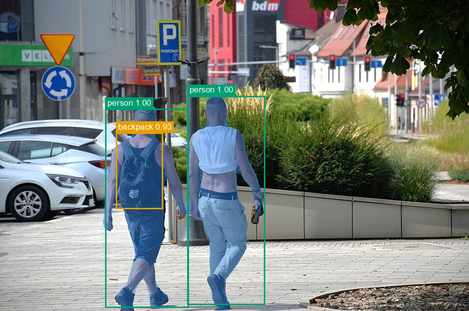

# 时尚图像检测与人物区域分割

基于课程示例整合 Faster R-CNN 与 DeepLabV3，使用预训练模型进行推理。提供本地 Streamlit 界面、批量处理脚本、5张测试图片和对应实验结果。

课程项目仓库：[xwooo/fashion-detection-demo](https://github.com/xwooo/fashion-detection-demo)。论文、答辩PPT与讲稿见 [deliverables](deliverables/)。

**能力边界：** 检测人物、背包、雨伞、手提包、领带、行李箱；分割的是整个人物区域，包含服装、头发与皮肤，不能区分上衣、裤子、裙子。该系统是课程基础演示，不是完整的细粒度服装解析系统。

## 环境与安装

当前项目使用 Windows、Python 3.13，以及项目目录内的 `.venv` 虚拟环境。PyTorch 是深度学习库，PyCharm 是开发工具，两者可以配合使用。

首次在新电脑上准备环境，在项目根目录打开 PowerShell：

```powershell
python -m venv .venv
.\.venv\Scripts\python.exe -m pip install -r requirements.txt
```

`requirements.txt` 面向可复现实验的CPU环境。若之后需要GPU，应按照 [PyTorch官方安装说明](https://pytorch.org/get-started/locally/)安装与驱动匹配的PyTorch和Torchvision，并重新验证结果。

## 在PyCharm中运行

1. 打开本项目文件夹。
2. 在设置中找到 Python Interpreter，添加本地已有解释器。
3. 选择 `D:\人工智能程序设计2026\.venv\Scripts\python.exe`。若项目移动到其他目录，请选择新目录下的解释器。
4. 打开 `run_demo.py`，右键运行。
5. 在本地浏览器选择示例或上传图片，点击“开始分析”。

解释器配置参考：[PyCharm官方说明](https://www.jetbrains.com/help/pycharm/creating-virtual-environment.html)。不需要再次创建虚拟环境。

## 命令行运行

```powershell
.\.venv\Scripts\python.exe run_demo.py
```

应用只监听本机地址。运行后可打开终端显示的 `http://127.0.0.1:8501`。首次分析会从PyTorch官方服务器下载模型，缓存放在项目的 `.cache/torch/hub/checkpoints/`，之后可以离线运行。下载失败时检查网络并重试。

批量复现实验：

```powershell
.\.venv\Scripts\python.exe run_batch.py
.\.venv\Scripts\python.exe run_batch.py --input examples/01_street_portrait.jpg --output results_single --threshold 0.5 --alpha 0.45
```

每张图片输出 `original.png`、`detection.png`、`segmentation.png`、`combined.png`、二值人物掩码 `mask.png` 和包含预测与耗时的 `metrics.json`。总览保存在 `results/summary.json`。

## 实现流程

原图按EXIF校正方向并转换为RGB。Faster R-CNN采用官方检测预处理，输出候选框、类别和置信度，再按指定类别与阈值筛选。DeepLabV3采用独立的官方分割预处理，将预测分数图恢复到原图尺寸后取最大类别，提取person掩码。最后在同一原图坐标系中叠加人物掩码和检测框。

默认权重固定为 `FasterRCNN_ResNet50_FPN_Weights.COCO_V1` 和 `DeepLabV3_ResNet50_Weights.COCO_WITH_VOC_LABELS_V1`。默认置信度为0.5、透明度为0.45。模型仅加载一次，界面通过缓存复用。

## 示例结果





全部5组结果见 `results/`。图像作者、原作品链接、许可和修改说明见 [图片来源](examples/SOURCES.md)。特别是第4张原图及相应带标注结果按 CC BY-SA 4.0 使用。其他图片分别适用其列明许可，项目不声称拥有原图版权。

## 实验说明

实验使用少量公开图片进行定性展示，未建立像素级或检测框人工标注。因此检测数量、置信度和人物区域占比都不代表准确率，不报告mAP或mIoU。耗时是当前电脑上的单次运行记录，包含预处理，不含模型加载、绘图和保存，不作为严格的性能基准。

## 验证与排查

```powershell
.\.venv\Scripts\python.exe -m unittest discover -s tests -v
.\.venv\Scripts\python.exe -m pip check
```

- `No module named torch`：检查PyCharm是否使用本项目 `.venv` 解释器。
- 首次下载较慢：等待权重下载完成，答辩前至少运行一次；也可从官方地址下载相同文件并放入上述缓存目录。
- 未检测到目标：检查图片内容，适当降低置信度；无检测结果属于有效输出，不应手动伪造框。
- 没有衣服类别：这是预训练权重的类别限制，不能通过修改显示标签解决。
- CPU处理较慢或内存不足：先缩小输入图片，再重试。
- 端口8501被占用：使用 `.\.venv\Scripts\python.exe -m streamlit run app.py --server.address 127.0.0.1 --server.port 8502`。

## 项目结构

```text
app.py                   本地交互界面
run_demo.py              PyCharm启动入口
run_batch.py             批量推理入口
fashion_demo/pipeline.py 模型、预处理、可视化与导出
requirements.txt         固定直接依赖
requirements-lock.txt    实际验证环境完整依赖
examples/                测试图片及来源许可
results/                 实际模型输出与记录
tests/                   图像处理单元测试
deliverables/            论文、答辩PPT和讲稿
```

## 工作分工

个人独立项目。作者负责需求分析、模型调用与系统集成、测试图片整理、实验分析、论文撰写和答辩材料准备。姓名、学号、班级在提交前由本人填写。

## 参考资料

- [Faster R-CNN论文](https://arxiv.org/abs/1506.01497)
- [DeepLabV3论文](https://arxiv.org/abs/1706.05587)
- [Torchvision检测模型文档](https://docs.pytorch.org/vision/main/models/generated/torchvision.models.detection.fasterrcnn_resnet50_fpn.html)
- [Torchvision分割模型文档](https://docs.pytorch.org/vision/main/models/generated/torchvision.models.segmentation.deeplabv3_resnet50.html)

课程原始课件、虚拟环境及模型权重不包含在公开仓库中。
